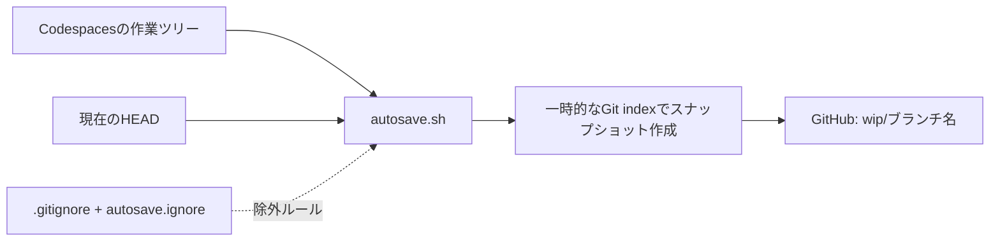
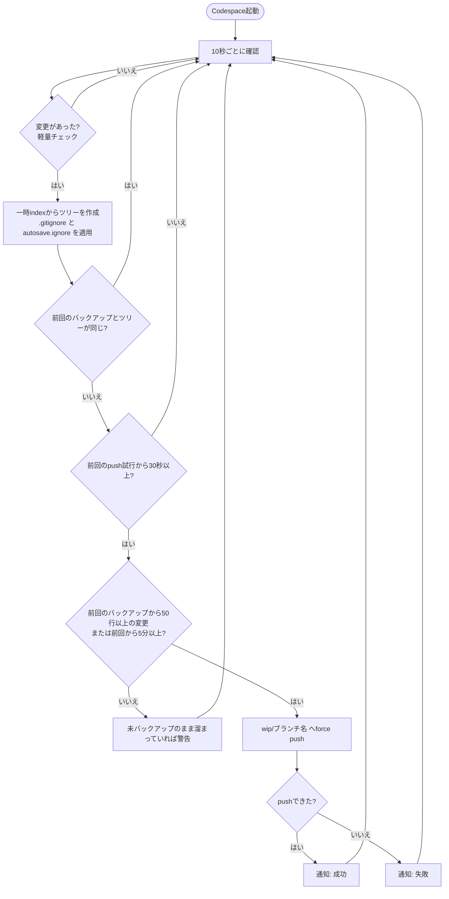

# Codespaces Autosnapshot - wip

[English](./README.md)

作業中のファイルを、専用のWIPブランチへ自動でバックアップする GitHub Codespaces 用テンプレートです。

pushする前にCodespaceが削除・消失してしまっても、**直近に成功したバックアップで保存されたファイル**をGitHubから復元できます。

## 特長

- **自動バックアップ** — 変更行数が閾値に達したとき、**または**一定時間が経ったときの、早いほうで実行します(デフォルト: 変更50行、または5分)。
- **未追跡ファイルも対象** — 新規ファイルも、`.gitignore` や `autosave.ignore` で除外されていなければ保存します。
- **除外ルールを設定可能** — 重いライブラリ、ビルド成果物、機密情報などを、`.gitignore` 形式のファイル(`.devcontainer/autosave.ignore`)でバックアップから外せます。主要言語向けのリストを同梱しています。
- **作業を邪魔しないスナップショット** — 一時的なGitのindexを使うため、作業ツリー、ステージ領域、stashは変更しません。
- **未pushのコミットも保護** — 作業ツリーに差分がないときは、現在の `HEAD` をバックアップします。
- **バックアップ専用ブランチ** — 通常のブランチには触れず、`wip/<ブランチ名>` へpushします。
- **無駄なpushを回避** — 前回成功したスナップショットとGitのツリーが同じなら、バックアップをスキップします。
- **ポップアップ通知** — 小さなVS Code拡張機能が、バックアップ成功時、変更が未バックアップのまま溜まったとき、push失敗時にポップアップで知らせます。

## 仕組み



`.devcontainer/autosave.sh` が定期的にファイルのスナップショットを作ります。本物のindexではなく一時的なindexを使い、除外ルールを適用したうえでコミットオブジェクトを作り、`wip/<現在のブランチ>` へforce pushします。スナップショットが `HEAD` と同じ内容なら、代わりに `HEAD` をpushします。



**注意:** バックアップするのはファイルの内容であり、「ステージ済みか未ステージか」という状態そのものではありません。スナップショットを復元しても、元のステージ領域は再現されません。

## はじめ方

### 1. このテンプレートからリポジトリを作る

GitHubで **Use this template** → **Create a new repository** を選びます。

### 2. Codespaceを起動する

作成したリポジトリで **Code** → **Codespaces** → **Create codespace on main** を選びます。

テンプレートに次のファイルが含まれていることを確認してください。

```text
.devcontainer/
├── autosave.sh
├── autosave.ignore
├── autosave-notify/      # ポップアップ通知用の拡張機能のインストーラー
└── devcontainer.json
```

`devcontainer.json` の `postStartCommand` が、Codespaceの起動時にバックアップスクリプトをバックグラウンドで開始します。

```json
{
  "postStartCommand": "nohup bash .devcontainer/autosave.sh \"$PWD\" >/tmp/autosave.log 2>&1 &",
  "postAttachCommand": "bash .devcontainer/autosave-notify/install.sh"
}
```

`postAttachCommand` は通知用の拡張機能をインストールします([通知](#通知)を参照)。

すでに `devcontainer.json` がある場合は、[既存のリポジトリに導入する](#既存のリポジトリに導入する)を参照してください。

### 3. 作業を始める

最初のバックアップは、デフォルトでは**変更が50行に達するか、5分が経ったとき**に実行されます。たとえば `feature/login` で作業している場合、バックアップは `wip/feature/login` に保存されます。

```text
feature/login       ← 通常の作業ブランチ
wip/feature/login   ← 自動バックアップ用ブランチ
```

WIPブランチは、pushに成功するとGitHub上に作成・更新されます。Codespaceにリモートリポジトリへのpush権限が必要です。

### 4. 動作を確認する

Codespaceのターミナルで実行します。

```bash
# スクリプトが動いているか
ps aux | grep '[a]utosave.sh'

# 今すぐ1回バックアップして、GitHub上にWIPブランチができたか確認
AUTOSAVE_ONCE=1 bash .devcontainer/autosave.sh "$PWD"
git ls-remote origin 'wip/*'
```

`wip/<作業中のブランチ名>` の行が表示されれば、バックアップできています。`ps` の結果が空の場合は、[トラブルシューティング](#トラブルシューティング)を確認してください。

## 前提条件

- `origin` リモートを持つ、GitHub上のリポジトリ。そこへpushできるCodespaceであること(自分のリポジトリなら、デフォルトで満たします)。
- `bash`、`git`、GNU coreutils。Codespacesの標準のdev containerイメージには入っています。Alpine系のイメージには入っていません。
- 通知の拡張機能には、さらにVS Codeの `code` コマンドが必要です([通知](#通知)を参照)。バックアップ自体は、なくても動きます。

## 既存のリポジトリに導入する

テンプレートからリポジトリを作らない場合の手順です。

**1. ファイルをコピーする。** リポジトリのルートで実行します(たとえばCodespace上で)。フォークを使う場合は、URLを置き換えてください。

```bash
git clone --depth 1 --branch template https://github.com/taka1156/codespaces-autosnapshot.git /tmp/autosnapshot
mkdir -p .devcontainer
cp -r /tmp/autosnapshot/.devcontainer/autosave.sh \
      /tmp/autosnapshot/.devcontainer/autosave.ignore \
      /tmp/autosnapshot/.devcontainer/autosave-notify \
      .devcontainer/
chmod +x .devcontainer/autosave.sh .devcontainer/autosave-notify/install.sh
```

**2. `devcontainer.json` にコマンドを登録する。** ファイルがない場合は、テンプレートの `devcontainer.json` もコピーしてください。すでにある場合は、次の2つのキーを追加します。

```json
{
  "postStartCommand": "nohup bash .devcontainer/autosave.sh \"$PWD\" >/tmp/autosave.log 2>&1 &",
  "postAttachCommand": "bash .devcontainer/autosave-notify/install.sh"
}
```

すでに `postStartCommand`(または `postAttachCommand`)を使っている場合は、置き換えないでください。複数のコマンドを並べて実行できるオブジェクト形式に変えます。

```json
{
  "postStartCommand": {
    "autosave": "nohup bash .devcontainer/autosave.sh \"$PWD\" >/tmp/autosave.log 2>&1 &",
    "my-existing-step": "echo your existing command here"
  },
  "postAttachCommand": "bash .devcontainer/autosave-notify/install.sh"
}
```

**3. `.devcontainer/autosave.ignore` を見直す。** 自分のソースを置いているフォルダ(たとえば `build/` や `vendor/`)の行があれば、削除してください。[バックアップから除外するファイル](#バックアップから除外するファイル)を参照してください。

**4. コミットしてpushする。** あとから作るCodespaceにファイルが入るのは、リポジトリに入っている場合だけです。

**5. 起動する。** コンテナを再構築する(コマンドパレットの **Codespaces: Rebuild Container**)か、再構築せずに今のCodespaceで直接起動します。

```bash
nohup bash .devcontainer/autosave.sh "$PWD" >/tmp/autosave.log 2>&1 &
bash .devcontainer/autosave-notify/install.sh
```

そのあと、[動作を確認する](#4-動作を確認する)に進んでください。

## 設定

| 項目 | 設定方法 | デフォルト |
| --- | --- | --- |
| 変更量の閾値 | `AUTOSAVE_CHANGE_THRESHOLD`(前回のバックアップからの変更行数。追加+削除で、バイナリは1ファイルを1と数える) | `50` |
| 最大間隔 | `AUTOSAVE_MAX_INTERVAL`(秒。変更があれば、この時間が経つとバックアップする) | `300`(5分) |
| 最小間隔 | `AUTOSAVE_MIN_INTERVAL`(秒。これより短い間隔ではpushしない) | `30` |
| 確認間隔 | `AUTOSAVE_POLL`(変更を確認する間隔、秒) | `10` |
| リポジトリのパス | `autosave.sh` の第1引数 | カレントディレクトリ |
| 除外ファイル | 環境変数 `AUTOSAVE_EXCLUDE_FILE`(絶対パス、またはリポジトリルートからの相対パス) | `.devcontainer/autosave.ignore` |
| バックアップ先 | `wip/<現在のブランチ>` | 固定 |

変更量の閾値に達したとき、**または**変更があって最大間隔が経ったときにバックアップします。ただし、前回の試行から最小間隔が経つまでは実行しません。変更量は前回成功したバックアップとの差で測ります(起動直後は `HEAD` との差です)。

毎回の確認では、ファイルのメタデータ(名前と更新時刻)を比べるだけなので軽く、追跡ファイルが3万個のリポジトリで1回あたり約0.1秒です。ファイルの中身を読むのは、変更があったときだけです。

たとえば、変更20行または2分でバックアップする場合:

```bash
AUTOSAVE_CHANGE_THRESHOLD=20 AUTOSAVE_MAX_INTERVAL=120 bash .devcontainer/autosave.sh "$PWD"
```

このコマンドはフォアグラウンドで動きます。自動で起動したプロセスと並行して、2つ目を動かさないでください。

すべてのCodespaceに設定する場合は、`devcontainer.json` の `containerEnv` を使います。

```json
{
  "containerEnv": {
    "AUTOSAVE_MAX_INTERVAL": "120",
    "AUTOSAVE_EXCLUDE_FILE": ".devcontainer/my-exclude.txt"
  }
}
```

## 通知

`autosave.sh` は、直近のイベントをステータスファイル(`/tmp/autosave.status`、JSON 1件)に書き出します。小さなVS Code拡張機能(`.devcontainer/autosave-notify/install.sh` でインストールします)がこのファイルを監視し、ポップアップで知らせます。

| イベント | ポップアップ | タイミング |
| --- | --- | --- |
| `success` | 情報 | 変更を含むバックアップに成功したとき(変更のない `HEAD` のpushは通知しません。ただし、失敗からの復旧時は通知します) |
| `pending` | 警告 | 変更が10分間バックアップされないまま残っているか、200行に達したとき |
| `failure` | エラー | pushに失敗したとき(Gitのエラーの1行目を含みます) |

同じ警告・失敗は、最大でも5分に1回しか繰り返しません。拡張機能がなくてもスクリプトは動きます(ステータスファイルが表示されないだけです)。

| 項目 | 設定方法 | デフォルト |
| --- | --- | --- |
| ステータスファイル | `AUTOSAVE_STATUS_FILE`(空にすると無効) | `/tmp/autosave.status` |
| 「pending」にする経過時間 | `AUTOSAVE_WARN_AFTER`(秒) | `600` |
| 「pending」にする変更量 | `AUTOSAVE_WARN_CHANGES`(変更行数) | `200` |
| 繰り返しの間隔 | `AUTOSAVE_NOTIFY_REPEAT`(秒) | `300` |

VS Codeの設定 `autosaveNotify.showSuccess`、`autosaveNotify.showPending`、`autosaveNotify.showFailure` で、種類ごとに表示を切り替えられます。メッセージはVS Codeの表示言語(日本語または英語)に合わせます。

拡張機能は、**リポジトリには含まれません**。このプロジェクトの[Releasesページ](https://github.com/taka1156/codespaces-autosnapshot/releases)に `.vsix` ファイルとして公開されていて、`install.sh` がそれをダウンロードし、`code` コマンドでインストールします。スクリプトはCodespaceの作成を失敗させません。`code` が見つからない場合やダウンロードできない場合は、ヒントを表示するだけで、バックアップはそのまま動きます。

```bash
bash .devcontainer/autosave-notify/install.sh           # インストール(入っていれば何もしない)
bash .devcontainer/autosave-notify/install.sh --force   # 再インストール・最新版への更新
```

- ダウンロード元は、このプロジェクトの**公開**リポジトリです。フォークや固定したリリースなど、別の場所を使う場合は、`AUTOSAVE_NOTIFY_VSIX_URL` を設定してください。
- そのリポジトリが公開しているコードを、あなたのVS Codeにインストールすることになります。バージョンを固定したい場合は、内容を確認したリリースを `AUTOSAVE_NOTIFY_VSIX_URL` で指定してください。
- 通知を完全にやめる場合は、`autosave-notify` フォルダと、`postAttachCommand` の行を削除してください。

**注意:** ポップアップは、実際のCodespaceではまだ確認できていません。スクリプトと拡張機能のロジックはテストで確認していますが、VS Code本体は対象外です。インストール後にポップアップが出ない場合は、**Developer: Reload Window** を実行してください。

## バックアップから除外するファイル

`.gitignore` または `.devcontainer/autosave.ignore` にマッチするファイルは、スナップショットに含まれません。`autosave.ignore` の書式は `.gitignore` と同じで(コメント、ディレクトリ指定、ワイルドカード、`!` による否定が使えます)、実行のたびに読み直されるため、編集すれば**再起動なしで**反映されます。

```gitignore
# 例
node_modules/
.env
.env.*
!.env.example     # .env.example はバックアップに含める
*.pem
```

同梱の `autosave.ignore` は、次のものをカバーしています。

| カテゴリー | 例 |
| --- | --- |
| 機密情報・環境変数 | `.env`、`.env.*`、`.envrc`、`credentials.json`、`*.tfstate`、`*.tfvars` |
| 秘密鍵・証明書 | `*.pem`、`*.key`、`id_rsa`、`id_ed25519`、`*.p12`、`*.jks`、`.ssh/` |
| クラウドの認証情報 | `.aws/`、`.azure/`、`.kube/config`、`.docker/config.json` |
| Node.js・フロントエンド | `node_modules/`、`.yarn/cache/`、`.next/`、`.nuxt/`、`.turbo/` |
| Python | `__pycache__/`、`.venv/`、`venv/`、`.pytest_cache/`、`.mypy_cache/` |
| Rust・Go・Java・.NET・Ruby・PHP・Elixir・Dart・Swift・C/C++ | `target/`、`vendor/`、`.gradle/`、`build/`、`obj/`、`_build/`、`.dart_tool/` |
| OS・エディタのファイル | `.DS_Store`、`Thumbs.db` |

全リストは [`.devcontainer/autosave.ignore`](./.devcontainer/autosave.ignore) にあります。プロジェクトに合わせて調整してください。

あるファイルがどのルールで除外されているかを確認するには、次のコマンドを使います。

```bash
git -c core.excludesFile=.devcontainer/autosave.ignore check-ignore -v path/to/file
```

## バックアップを復元する

`feature/login` のバックアップを確認するには:

```bash
git fetch origin

# バックアップブランチが存在することを確認
git log -1 origin/wip/feature/login

# 差分を確認
git diff feature/login origin/wip/feature/login
```

**復元先にあるローカルの変更は、先に退避してください。** そのうえで、対象のブランチをチェックアウトし、バックアップからファイルを復元します。

```bash
git switch feature/login
git restore --source=origin/wip/feature/login --worktree -- .
```

この操作は、バックアップに含まれるパスを上書きします。復元先にだけ存在するファイルは、自動では削除されません。未pushのコミットも必要な場合は、バックアップブランチの履歴を `git log` で確認し、`git cherry-pick` など適切なGit操作で選んで取り込んでください。

`.gitignore` や `autosave.ignore` で除外されたファイル(`node_modules` や `.env` など)はバックアップに含まれないため、復元後に再インストール・再作成してください。

## 制限事項とセキュリティ

- `.gitignore` や `autosave.ignore` で除外されたファイル(`.env`、`node_modules` など)はバックアップされず、WIPブランチからも復元できません。
- **除外ルールに入っていない秘密情報は、WIPブランチにpushされる可能性があります。** 同梱の `autosave.ignore` は一般的なパターンをカバーしていますが、あなたのプロジェクト固有のファイル名までは分かりません。秘密鍵、APIトークン、認証情報は、プロジェクトに合わせて追加してください。
- **除外ルールが効くのは、未追跡のファイルだけです。** すでにGitで追跡されているファイルは、パターンにマッチしてもバックアップされます。誤って秘密情報をコミットした場合は、`git rm --cached` で追跡から外してください。
- 同梱のルールは `build/`、`dist/`、`vendor/`、`*.jar` などを除外します。ソースや必要なファイルをそこに置くプロジェクトでは、該当する行を削除してください。
- `.gitignore` 側の `!pattern`(否定)が、`autosave.ignore` より優先されることがあります。
- 除外されていない大きなファイルやデータセットは含まれるため、pushが遅くなります。
- 直近のバックアップ以降の変更は失われる可能性があります(デフォルトでは、変更が50行に達するか5分が経つまで。これに10秒の確認間隔とネットワークの遅延が加わります)。
- push権限が必要です。pushに失敗した場合、バックアップは更新されません。
- Detached HEAD の状態はスキップされます。
- WIPブランチは**force push**で更新されるため、以前のWIPの履歴が残る保証はありません。同じブランチを複数のCodespaceで使うと、バックアップが競合する可能性があるので避けてください。
- シャットダウンや削除を検知するフックではありません。大事な作業は、これまでどおり `git commit` と `git push` で保存してください。

不要になったバックアップブランチを削除するには:

```bash
git push origin --delete wip/feature/login
```

## トラブルシューティング

| 症状 | 確認すること |
| --- | --- |
| WIPブランチができない | 最初のインターバルを待ってから、`ps aux \| grep '[a]utosave.sh'` と `/tmp/autosave.log` を確認 |
| 新しいファイルが入っていない | `git -c core.excludesFile=.devcontainer/autosave.ignore check-ignore -v path/to/file` で、どのルールにマッチしているか確認 |
| 除外したはずのファイルがバックアップされる | すでに追跡されていないか確認: `git ls-files path/to/file` |
| 除外ルールが効いていない | `/tmp/autosave.log` に `exclude file not found` が出ていないか、`AUTOSAVE_EXCLUDE_FILE` のパスを確認 |
| pushできない | GitHubの認証、書き込み権限、ブランチ保護ルールを確認 |
| ポップアップが出ない | 拡張機能が入っているか(`code --list-extensions`)、**Developer: Reload Window** を実行したか、`/tmp/autosave.status` の中身を確認 |
| プロセスが止まった | `.devcontainer/devcontainer.json` を確認し、Codespaceを再起動 |

実装の詳細は、[元のGist](https://gist.github.com/taka1156/9b68f2481a040787513cea815b35815e)を参照してください。
