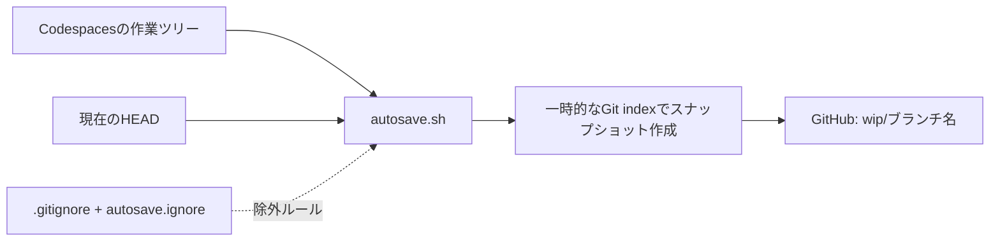
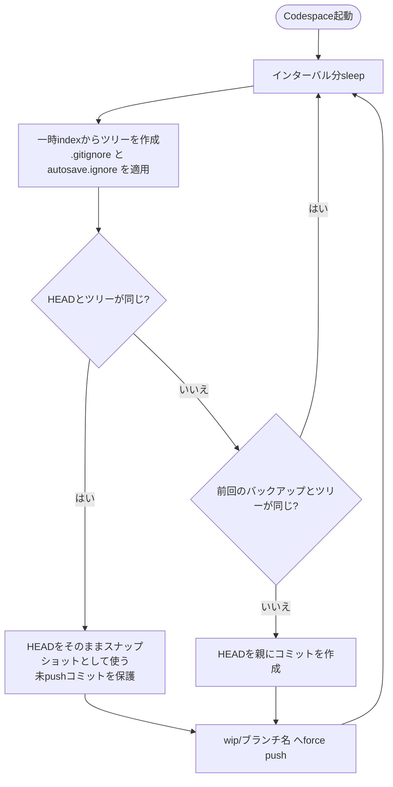

# Codespaces Autosnapshot - wip

[English Version](./README.md)

作業中のファイルを、専用のWIPブランチへ自動でバックアップする GitHub Codespaces 用テンプレートです。

pushする前にCodespaceが削除・消失してしまっても、**直近に成功したバックアップで保存されたファイル**をGitHubから復元できます。

## 特長

- **自動バックアップ** — デフォルトでは5分ごとに実行します。
- **未追跡ファイルも対象** — 新規ファイルも、`.gitignore` や `autosave.ignore` で除外されていなければ保存します。
- **除外ルールを設定可能** — 重いライブラリ、ビルド成果物、機密情報などを、`.gitignore` 形式のファイル(`.devcontainer/autosave.ignore`)でバックアップから外せます。主要言語向けのリストを同梱しています。
- **作業を邪魔しないスナップショット** — 一時的なGitのindexを使うため、作業ツリー、ステージ領域、stashは変更しません。
- **未pushのコミットも保護** — 作業ツリーに差分がないときは、現在の `HEAD` をバックアップします。
- **バックアップ専用ブランチ** — 通常のブランチには触れず、`wip/<ブランチ名>` へpushします。
- **無駄なpushを回避** — 前回成功したスナップショットとGitのツリーが同じなら、バックアップをスキップします。

## 仕組み



`.devcontainer/autosave.sh` が定期的にファイルのスナップショットを作ります。本物のindexではなく一時的なindexを使い、除外ルールを適用したうえでコミットオブジェクトを作り、`wip/<現在のブランチ>` へforce pushします。スナップショットが `HEAD` と同じ内容なら、代わりに `HEAD` をpushします。



**注意:** バックアップするのはファイルの内容であり、「ステージ済みか未ステージか」という状態そのものではありません。スナップショットを復元しても、元のステージ領域は再現されません。

## はじめ方

### 1. このテンプレートからリポジトリを作る

GitHubで **Use this template** → **Create a new repository** を選びます。

### 2. Codespaceを起動する

作成したリポジトリで **Code** → **Codespaces** → **Create codespace on main** を選びます。

テンプレートに次のファイルが含まれていることを確認してください。

```text
.devcontainer/
├── autosave.sh
├── autosave.ignore
└── devcontainer.json
```

`devcontainer.json` の `postStartCommand` が、Codespaceの起動時にバックアップスクリプトをバックグラウンドで開始します。

```json
{
  "postStartCommand": "nohup bash .devcontainer/autosave.sh \"$PWD\" >/tmp/autosave.log 2>&1 &"
}
```

すでに `devcontainer.json` がある場合は、ファイル全体を置き換えず、このコマンドを既存の設定に組み込んでください。

### 3. 作業を始める

最初のバックアップは、デフォルトでは**最初の300秒のインターバルが過ぎたあと**に実行されます。たとえば `feature/login` で作業している場合、バックアップは `wip/feature/login` に保存されます。

```text
feature/login       ← 通常の作業ブランチ
wip/feature/login   ← 自動バックアップ用ブランチ
```

WIPブランチは、pushに成功するとGitHub上に作成・更新されます。Codespaceにリモートリポジトリへのpush権限が必要です。

## 設定

| 項目 | 設定方法 | デフォルト |
| --- | --- | --- |
| バックアップ間隔 | 環境変数 `AUTOSAVE_INTERVAL`(秒) | `300`(5分) |
| リポジトリのパス | `autosave.sh` の第1引数 | カレントディレクトリ |
| 除外ファイル | 環境変数 `AUTOSAVE_EXCLUDE_FILE`(絶対パス、またはリポジトリルートからの相対パス) | `.devcontainer/autosave.ignore` |
| バックアップ先 | `wip/<現在のブランチ>` | 固定 |

たとえば、60秒ごとに実行する場合:

```bash
AUTOSAVE_INTERVAL=60 bash .devcontainer/autosave.sh "$PWD"
```

このコマンドはフォアグラウンドで動きます。自動で起動したプロセスと並行して、2つ目を動かさないでください。

すべてのCodespaceに設定する場合は、`devcontainer.json` の `containerEnv` を使います。

```json
{
  "containerEnv": {
    "AUTOSAVE_INTERVAL": "120",
    "AUTOSAVE_EXCLUDE_FILE": ".devcontainer/my-exclude.txt"
  }
}
```

## バックアップから除外するファイル

`.gitignore` または `.devcontainer/autosave.ignore` にマッチするファイルは、スナップショットに含まれません。`autosave.ignore` の書式は `.gitignore` と同じで(コメント、ディレクトリ指定、ワイルドカード、`!` による否定が使えます)、実行のたびに読み直されるため、編集すれば**再起動なしで**反映されます。

```gitignore
# 例
node_modules/
.env
.env.*
!.env.example     # .env.example はバックアップに含める
*.pem
```

同梱の `autosave.ignore` は、次のものをカバーしています。

| カテゴリー | 例 |
| --- | --- |
| 機密情報・環境変数 | `.env`、`.env.*`、`.envrc`、`credentials.json`、`*.tfstate`、`*.tfvars` |
| 秘密鍵・証明書 | `*.pem`、`*.key`、`id_rsa`、`id_ed25519`、`*.p12`、`*.jks`、`.ssh/` |
| クラウドの認証情報 | `.aws/`、`.azure/`、`.kube/config`、`.docker/config.json` |
| Node.js・フロントエンド | `node_modules/`、`.yarn/cache/`、`.next/`、`.nuxt/`、`.turbo/` |
| Python | `__pycache__/`、`.venv/`、`venv/`、`.pytest_cache/`、`.mypy_cache/` |
| Rust・Go・Java・.NET・Ruby・PHP・Elixir・Dart・Swift・C/C++ | `target/`、`vendor/`、`.gradle/`、`build/`、`obj/`、`_build/`、`.dart_tool/` |
| OS・エディタのファイル | `.DS_Store`、`Thumbs.db` |

全リストは [`.devcontainer/autosave.ignore`](./.devcontainer/autosave.ignore) にあります。プロジェクトに合わせて調整してください。

あるファイルがどのルールで除外されているかを確認するには、次のコマンドを使います。

```bash
git -c core.excludesFile=.devcontainer/autosave.ignore check-ignore -v path/to/file
```

## バックアップを復元する

`feature/login` のバックアップを確認するには:

```bash
git fetch origin

# バックアップブランチが存在することを確認
git log -1 origin/wip/feature/login

# 差分を確認
git diff feature/login origin/wip/feature/login
```

**復元先にあるローカルの変更は、先に退避してください。** そのうえで、対象のブランチをチェックアウトし、バックアップからファイルを復元します。

```bash
git switch feature/login
git restore --source=origin/wip/feature/login --worktree -- .
```

この操作は、バックアップに含まれるパスを上書きします。復元先にだけ存在するファイルは、自動では削除されません。未pushのコミットも必要な場合は、バックアップブランチの履歴を `git log` で確認し、`git cherry-pick` など適切なGit操作で選んで取り込んでください。

`.gitignore` や `autosave.ignore` で除外されたファイル(`node_modules` や `.env` など)はバックアップに含まれないため、復元後に再インストール・再作成してください。

## 制限事項とセキュリティ

- `.gitignore` や `autosave.ignore` で除外されたファイル(`.env`、`node_modules` など)はバックアップされず、WIPブランチからも復元できません。
- **除外ルールに入っていない秘密情報は、WIPブランチにpushされる可能性があります。** 同梱の `autosave.ignore` は一般的なパターンをカバーしていますが、あなたのプロジェクト固有のファイル名までは分かりません。秘密鍵、APIトークン、認証情報は、プロジェクトに合わせて追加してください。
- **除外ルールが効くのは、未追跡のファイルだけです。** すでにGitで追跡されているファイルは、パターンにマッチしてもバックアップされます。誤って秘密情報をコミットした場合は、`git rm --cached` で追跡から外してください。
- 同梱のルールは `build/`、`dist/`、`vendor/`、`*.jar` などを除外します。ソースや必要なファイルをそこに置くプロジェクトでは、該当する行を削除してください。
- `.gitignore` 側の `!pattern`(否定)が、`autosave.ignore` より優先されることがあります。
- 除外されていない大きなファイルやデータセットは含まれるため、pushが遅くなります。
- 直近のバックアップ以降の変更は失われる可能性があります(デフォルトでは最大5分程度に、実行時間とネットワークの遅延が加わります)。
- push権限が必要です。pushに失敗した場合、バックアップは更新されません。
- Detached HEAD の状態はスキップされます。
- WIPブランチは**force push**で更新されるため、以前のWIPの履歴が残る保証はありません。同じブランチを複数のCodespaceで使うと、バックアップが競合する可能性があるので避けてください。
- シャットダウンや削除を検知するフックではありません。大事な作業は、これまでどおり `git commit` と `git push` で保存してください。

不要になったバックアップブランチを削除するには:

```bash
git push origin --delete wip/feature/login
```

## トラブルシューティング

| 症状 | 確認すること |
| --- | --- |
| WIPブランチができない | 最初のインターバルを待ってから、`ps aux \| grep '[a]utosave.sh'` と `/tmp/autosave.log` を確認 |
| 新しいファイルが入っていない | `git -c core.excludesFile=.devcontainer/autosave.ignore check-ignore -v path/to/file` で、どのルールにマッチしているか確認 |
| 除外したはずのファイルがバックアップされる | すでに追跡されていないか確認: `git ls-files path/to/file` |
| 除外ルールが効いていない | `/tmp/autosave.log` に `exclude file not found` が出ていないか、`AUTOSAVE_EXCLUDE_FILE` のパスを確認 |
| pushできない | GitHubの認証、書き込み権限、ブランチ保護ルールを確認 |
| プロセスが止まった | `.devcontainer/devcontainer.json` を確認し、Codespaceを再起動 |

実装の詳細は、[元のGist](https://gist.github.com/taka1156/9b68f2481a040787513cea815b35815e)を参照してください。