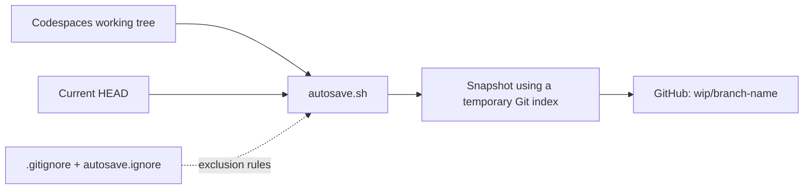
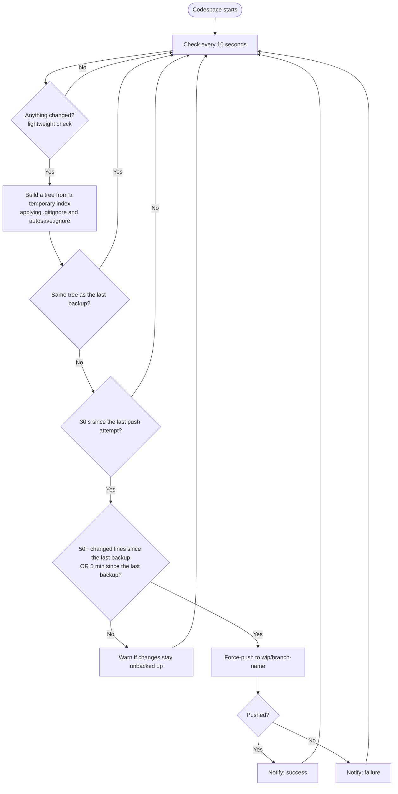

# Codespaces Autosnapshot - wip

[日本語はこちら](./README.ja.md)

A GitHub Codespaces template that automatically backs up your working files to dedicated WIP branches.

If your Codespace is deleted or lost before you push your work, you can recover **the files captured by the most recent successful backup** from GitHub.

## Features

- **Automatic backups** — Backs up when enough lines have changed **or** enough time has passed, whichever comes first (defaults: 50 changed lines, or 5 minutes).
- **Untracked files included** — Captures new files unless excluded by `.gitignore` or `autosave.ignore`.
- **Configurable exclusions** — Keep heavy dependencies, build output, and secrets out of the backup with a `.gitignore`-style file (`.devcontainer/autosave.ignore`). A ready-to-use list for major languages is included.
- **Non-disruptive snapshots** — Uses a temporary Git index without changing your working tree, staging area, or stash.
- **Protects unpushed commits** — Backs up the current `HEAD` when the working tree has no differences.
- **Separate backup branches** — Pushes to `wip/<branch-name>` without changing your normal branch.
- **Avoids redundant pushes** — Skips backups when the Git tree matches the previous successful snapshot.
- **Pop-up notifications** — A small VS Code extension shows a pop-up when a backup succeeds, when changes stay unbacked up, or when a push fails.

## How it works



`.devcontainer/autosave.sh` periodically creates a snapshot of your files. It uses a temporary index instead of your actual Git index, applies the exclusion rules, creates a commit object, and force-pushes it to `wip/<current-branch>`. If the snapshot matches `HEAD`, it pushes `HEAD` instead.



**Note:** This backs up file contents, not the exact staged-versus-unstaged state. Restoring a snapshot does not reconstruct the original staging area.

## Getting started

### 1. Create a repository from this template

Select **Use this template** → **Create a new repository** on GitHub.

### 2. Launch a Codespace

In your new repository, select **Code** → **Codespaces** → **Create codespace on main**.

Make sure the template includes:

```text
.devcontainer/
├── autosave.sh
├── autosave.ignore
├── autosave-notify/      # installer for the pop-up notification extension
└── devcontainer.json
```

The `postStartCommand` in `devcontainer.json` starts the backup script in the background whenever the Codespace starts:

```json
{
  "postStartCommand": "nohup bash .devcontainer/autosave.sh \"$PWD\" >/tmp/autosave.log 2>&1 &",
  "postAttachCommand": "bash .devcontainer/autosave-notify/install.sh"
}
```

`postAttachCommand` installs the notification extension (see [Notifications](#notifications)).

If you already have a `devcontainer.json`, see [Add it to an existing repository](#add-it-to-an-existing-repository).

### 3. Start working

The first backup runs once **50 lines have changed or 5 minutes have passed** (the defaults). For example, if you work on `feature/login`, its backup goes to `wip/feature/login`:

```text
feature/login       ← Normal working branch
wip/feature/login   ← Automatic backup branch
```

The WIP branch is created or updated on GitHub after a successful push. Your Codespace must have permission to push to the remote repository.

### 4. Check that it works

In the Codespace terminal:

```bash
# The script is running
ps aux | grep '[a]utosave.sh'

# Take one backup right now and look for the WIP branch on GitHub
AUTOSAVE_ONCE=1 bash .devcontainer/autosave.sh "$PWD"
git ls-remote origin 'wip/*'
```

If a `wip/<your-branch>` line appears, the backup works. If the `ps` line is empty, see [Troubleshooting](#troubleshooting).

## Requirements

- A repository hosted on GitHub with an `origin` remote, and a Codespace that can push to it (the default for your own repositories).
- `bash`, `git`, and GNU coreutils. The default Codespaces/dev container images include them. Alpine-based images do not.
- The notification extension additionally needs the VS Code `code` command (see [Notifications](#notifications)). Backups work without it.

## Add it to an existing repository

Use this when you do not create the repository from the template.

**1. Copy the files** into your repository (run in the repository root, for example in a Codespace). Replace the URL if you use a fork:

```bash
git clone --depth 1 --branch template https://github.com/taka1156/codespaces-autosnapshot.git /tmp/autosnapshot
mkdir -p .devcontainer
cp -r /tmp/autosnapshot/.devcontainer/autosave.sh \
      /tmp/autosnapshot/.devcontainer/autosave.ignore \
      /tmp/autosnapshot/.devcontainer/autosave-notify \
      .devcontainer/
chmod +x .devcontainer/autosave.sh .devcontainer/autosave-notify/install.sh
```

**2. Register the commands in your `devcontainer.json`.** If you have none, copy `devcontainer.json` from the template as well. Otherwise add these two keys:

```json
{
  "postStartCommand": "nohup bash .devcontainer/autosave.sh \"$PWD\" >/tmp/autosave.log 2>&1 &",
  "postAttachCommand": "bash .devcontainer/autosave-notify/install.sh"
}
```

If you already use `postStartCommand` (or `postAttachCommand`), do not replace it. Convert it to the object form, which runs the entries side by side:

```json
{
  "postStartCommand": {
    "autosave": "nohup bash .devcontainer/autosave.sh \"$PWD\" >/tmp/autosave.log 2>&1 &",
    "my-existing-step": "echo your existing command here"
  },
  "postAttachCommand": "bash .devcontainer/autosave-notify/install.sh"
}
```

**3. Review `.devcontainer/autosave.ignore`** and remove lines for folders that hold your own source (for example `build/` or `vendor/`). See [Excluding files from backups](#excluding-files-from-backups).

**4. Commit and push** the new files. A Codespace created later only gets them if they are in the repository.

**5. Start it.** Either rebuild the container (**Codespaces: Rebuild Container** in the command palette), or start it in the current Codespace without rebuilding:

```bash
nohup bash .devcontainer/autosave.sh "$PWD" >/tmp/autosave.log 2>&1 &
bash .devcontainer/autosave-notify/install.sh
```

Then follow [Check that it works](#4-check-that-it-works).

## Configuration

| Option | How to configure | Default |
| --- | --- | --- |
| Change threshold | `AUTOSAVE_CHANGE_THRESHOLD` (changed lines since the last backup: added + deleted, a binary file counts as 1) | `50` |
| Maximum interval | `AUTOSAVE_MAX_INTERVAL` (seconds; backs up after this long if anything changed) | `300` (5 minutes) |
| Minimum interval | `AUTOSAVE_MIN_INTERVAL` (seconds; never pushes more often than this) | `30` |
| Check interval | `AUTOSAVE_POLL` (seconds between change checks) | `10` |
| Repository path | First argument to `autosave.sh` | Current working directory |
| Exclusion file | `AUTOSAVE_EXCLUDE_FILE` environment variable (absolute path, or relative to the repository root) | `.devcontainer/autosave.ignore` |
| Backup destination | `wip/<current-branch>` | Fixed |

A backup is made when **either** the change threshold is reached **or** the maximum interval has passed with something changed — but never sooner than the minimum interval after the previous attempt. The amount of change is measured against the last successful backup (against `HEAD` right after start).

Each check only compares file metadata (names and timestamps), so it is cheap: about 0.1 s for a repository with 30,000 tracked files. File contents are read only when something has changed.

For example, to back up after 20 changed lines or 2 minutes:

```bash
AUTOSAVE_CHANGE_THRESHOLD=20 AUTOSAVE_MAX_INTERVAL=120 bash .devcontainer/autosave.sh "$PWD"
```

This command runs in the foreground. Avoid running a second instance alongside the automatically started process.

To set the options for every Codespace, use `containerEnv` in `devcontainer.json`:

```json
{
  "containerEnv": {
    "AUTOSAVE_MAX_INTERVAL": "120",
    "AUTOSAVE_EXCLUDE_FILE": ".devcontainer/my-exclude.txt"
  }
}
```

## Notifications

`autosave.sh` writes its latest event to a status file (`/tmp/autosave.status`, one JSON object). A small VS Code extension (installed by `.devcontainer/autosave-notify/install.sh`) watches that file and shows a pop-up:

| Event | Pop-up | When |
| --- | --- | --- |
| `success` | Information | A backup with changes succeeded (an unchanged `HEAD` is pushed silently, unless it recovers from failures) |
| `pending` | Warning | Changes have stayed unbacked up for 10 minutes, or reached 200 changed lines |
| `failure` | Error | A push failed (the message includes the first line of Git's error) |

The same warning or failure is repeated at most every 5 minutes. The script works without the extension; the status file is simply not shown.

| Option | How to configure | Default |
| --- | --- | --- |
| Status file | `AUTOSAVE_STATUS_FILE` (empty = disabled) | `/tmp/autosave.status` |
| "Pending" after | `AUTOSAVE_WARN_AFTER` (seconds) | `600` |
| "Pending" at | `AUTOSAVE_WARN_CHANGES` (changed lines) | `200` |
| Repeat interval | `AUTOSAVE_NOTIFY_REPEAT` (seconds) | `300` |

In VS Code, the settings `autosaveNotify.showSuccess`, `autosaveNotify.showPending`, and `autosaveNotify.showFailure` switch each kind on or off. Messages follow the VS Code display language (Japanese or English).

The extension is **not stored in your repository**. It is published as a `.vsix` file on the [Releases page](https://github.com/taka1156/codespaces-autosnapshot/releases) of this project, and `install.sh` downloads it and installs it with the `code` command. The script never fails the Codespace: if it cannot find `code` or cannot download the file, it only prints a hint, and the backups keep working.

```bash
bash .devcontainer/autosave-notify/install.sh           # install (skipped if already installed)
bash .devcontainer/autosave-notify/install.sh --force   # reinstall / update to the latest build
```

- The download comes from this project's **public** repository. To use another source (a fork, or a fixed release), set `AUTOSAVE_NOTIFY_VSIX_URL`.
- You are installing code published by that repository into your VS Code. Point `AUTOSAVE_NOTIFY_VSIX_URL` at a release you have reviewed if you want a fixed version.
- To turn notifications off completely, delete the `autosave-notify` folder and the `postAttachCommand` line.

**Note:** the pop-ups have not been verified in a real Codespace yet. The script and the extension logic are covered by tests, but not VS Code itself. If no pop-up appears after installing, run **Developer: Reload Window**.

## Excluding files from backups

Files matching `.gitignore` or `.devcontainer/autosave.ignore` are left out of the snapshot. `autosave.ignore` uses the same syntax as `.gitignore` (comments, directory patterns, wildcards, and `!` negation), and it is re-read on every run, so edits take effect **without restarting** the script.

```gitignore
# Example
node_modules/
.env
.env.*
!.env.example     # keep .env.example in the backup
*.pem
```

The bundled `autosave.ignore` covers:

| Category | Examples |
| --- | --- |
| Secrets and environment variables | `.env`, `.env.*`, `.envrc`, `credentials.json`, `*.tfstate`, `*.tfvars` |
| Private keys and certificates | `*.pem`, `*.key`, `id_rsa`, `id_ed25519`, `*.p12`, `*.jks`, `.ssh/` |
| Cloud credentials | `.aws/`, `.azure/`, `.kube/config`, `.docker/config.json` |
| Node.js and frontend | `node_modules/`, `.yarn/cache/`, `.next/`, `.nuxt/`, `.turbo/` |
| Python | `__pycache__/`, `.venv/`, `venv/`, `.pytest_cache/`, `.mypy_cache/` |
| Rust, Go, Java, .NET, Ruby, PHP, Elixir, Dart, Swift, C/C++ | `target/`, `vendor/`, `.gradle/`, `build/`, `obj/`, `_build/`, `.dart_tool/` |
| OS and editor files | `.DS_Store`, `Thumbs.db` |

The full list is in [`.devcontainer/autosave.ignore`](./.devcontainer/autosave.ignore). Adjust it to your project.

To check which rule excludes a file:

```bash
git -c core.excludesFile=.devcontainer/autosave.ignore check-ignore -v path/to/file
```

## Restore a backup

To inspect a backup of `feature/login`:

```bash
git fetch origin

# Confirm the backup branch exists
git log -1 origin/wip/feature/login

# Review differences
git diff feature/login origin/wip/feature/login
```

**Save any local changes in the destination first.** Then check out the target branch and restore files from the backup:

```bash
git switch feature/login
git restore --source=origin/wip/feature/login --worktree -- .
```

This overwrites paths present in the backup. Files that exist only in the destination are not automatically deleted. If you also need unpushed commits, inspect the backup branch's history with `git log` and selectively bring them over with `git cherry-pick` or another suitable Git operation.

Files excluded by `.gitignore` or `autosave.ignore` (such as `node_modules` or `.env`) are not in the backup, so reinstall or recreate them after restoring.

## Limitations and security

- Files excluded by `.gitignore` or `autosave.ignore` (such as `.env` or `node_modules`) are not backed up and cannot be recovered from the WIP branch.
- **Secrets not covered by an exclusion rule may be pushed to the WIP branch.** The bundled `autosave.ignore` covers common patterns, but it cannot know your own file names. Add private keys, API tokens, and credentials specific to your project.
- **Exclusion rules only apply to untracked files.** A file already tracked by Git is backed up even if it matches a pattern. If you committed a secret by mistake, remove it from tracking with `git rm --cached`.
- The bundled rules exclude `build/`, `dist/`, `vendor/`, `*.jar`, and similar paths. If your project keeps source or required files there, remove those lines.
- A `!pattern` (negation) in `.gitignore` may take precedence over `autosave.ignore`.
- Large files and datasets that are not excluded will be included, making pushes slower.
- Changes made after the most recent backup may be lost (by default, until 50 lines have changed or 5 minutes have passed, plus the 10-second check interval and network delays).
- Push access is required. A failed push does not update the backup.
- Detached HEAD checkouts are skipped.
- WIP branches are updated with **force pushes**, so previous WIP history is not guaranteed to remain available. Avoid conflicting backups from multiple Codespaces on the same branch.
- This does not provide a guaranteed shutdown or deletion hook. Continue using regular `git commit` and `git push` for important work.

To remove an obsolete backup branch:

```bash
git push origin --delete wip/feature/login
```

## Troubleshooting

| Problem | What to check |
| --- | --- |
| No WIP branch appears | Wait for the first interval, then check `ps aux \| grep '[a]utosave.sh'` and `/tmp/autosave.log` |
| A new file is missing | Check which rule matches with `git -c core.excludesFile=.devcontainer/autosave.ignore check-ignore -v path/to/file` |
| A file that should be excluded is backed up | Check whether it is already tracked: `git ls-files path/to/file` |
| Exclusion rules are not applied | Look for `exclude file not found` in `/tmp/autosave.log` and verify the path of `AUTOSAVE_EXCLUDE_FILE` |
| Push is not working | Verify GitHub authentication, write permissions, and branch protection rules |
| No pop-up appears | Check that the extension is installed (`code --list-extensions`), run **Developer: Reload Window**, and look at `/tmp/autosave.status` |
| The process stopped | Check `.devcontainer/devcontainer.json` and restart the Codespace |

See the [original Gist](https://gist.github.com/taka1156/9b68f2481a040787513cea815b35815e) for implementation details.
