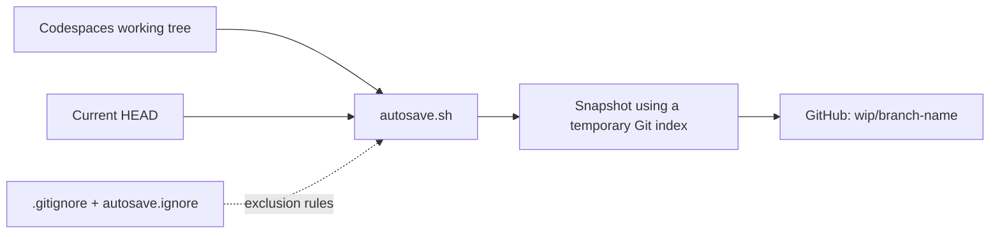
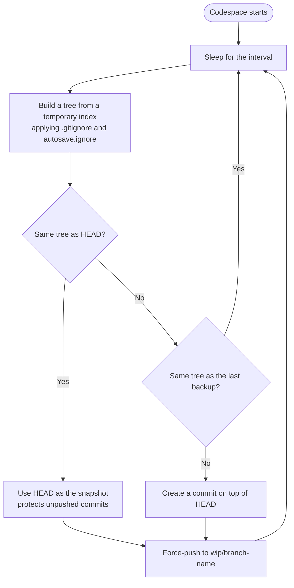

# Codespaces Autosnapshot - wip
 
[日本語はこちら](./README.ja.md)
 
A GitHub Codespaces template that automatically backs up your working files to dedicated WIP branches.
 
If your Codespace is deleted or lost before you push your work, you can recover **the files captured by the most recent successful backup** from GitHub.
 
## Features
 
- **Automatic backups** — Runs every five minutes by default.
- **Untracked files included** — Captures new files unless excluded by `.gitignore` or `autosave.ignore`.
- **Configurable exclusions** — Keep heavy dependencies, build output, and secrets out of the backup with a `.gitignore`-style file (`.devcontainer/autosave.ignore`). A ready-to-use list for major languages is included.
- **Non-disruptive snapshots** — Uses a temporary Git index without changing your working tree, staging area, or stash.
- **Protects unpushed commits** — Backs up the current `HEAD` when the working tree has no differences.
- **Separate backup branches** — Pushes to `wip/<branch-name>` without changing your normal branch.
- **Avoids redundant pushes** — Skips backups when the Git tree matches the previous successful snapshot.
## How it works
 

 
`.devcontainer/autosave.sh` periodically creates a snapshot of your files. It uses a temporary index instead of your actual Git index, applies the exclusion rules, creates a commit object, and force-pushes it to `wip/<current-branch>`. If the snapshot matches `HEAD`, it pushes `HEAD` instead.
 

 
**Note:** This backs up file contents, not the exact staged-versus-unstaged state. Restoring a snapshot does not reconstruct the original staging area.
 
## Getting started
 
### 1. Create a repository from this template
 
Select **Use this template** → **Create a new repository** on GitHub.
 
### 2. Launch a Codespace
 
In your new repository, select **Code** → **Codespaces** → **Create codespace on main**.
 
Make sure the template includes:
 
```text
.devcontainer/
├── autosave.sh
├── autosave.ignore
└── devcontainer.json
```
 
The `postStartCommand` in `devcontainer.json` starts the backup script in the background whenever the Codespace starts:
 
```json
{
  "postStartCommand": "nohup bash .devcontainer/autosave.sh \"$PWD\" >/tmp/autosave.log 2>&1 &"
}
```
 
If you already have a `devcontainer.json`, integrate this command with its existing settings rather than replacing the entire file.
 
### 3. Start working
 
The first backup runs **after the initial 300-second interval** by default. For example, if you work on `feature/login`, its backup goes to `wip/feature/login`:
 
```text
feature/login       ← Normal working branch
wip/feature/login   ← Automatic backup branch
```
 
The WIP branch is created or updated on GitHub after a successful push. Your Codespace must have permission to push to the remote repository.
 
## Configuration
 
| Option | How to configure | Default |
| --- | --- | --- |
| Backup interval | `AUTOSAVE_INTERVAL` environment variable (seconds) | `300` (5 minutes) |
| Repository path | First argument to `autosave.sh` | Current working directory |
| Exclusion file | `AUTOSAVE_EXCLUDE_FILE` environment variable (absolute path, or relative to the repository root) | `.devcontainer/autosave.ignore` |
| Backup destination | `wip/<current-branch>` | Fixed |
 
For example, to run the script every 60 seconds:
 
```bash
AUTOSAVE_INTERVAL=60 bash .devcontainer/autosave.sh "$PWD"
```
 
This command runs in the foreground. Avoid running a second instance alongside the automatically started process.
 
To set the options for every Codespace, use `containerEnv` in `devcontainer.json`:
 
```json
{
  "containerEnv": {
    "AUTOSAVE_INTERVAL": "120",
    "AUTOSAVE_EXCLUDE_FILE": ".devcontainer/my-exclude.txt"
  }
}
```
 
## Excluding files from backups
 
Files matching `.gitignore` or `.devcontainer/autosave.ignore` are left out of the snapshot. `autosave.ignore` uses the same syntax as `.gitignore` (comments, directory patterns, wildcards, and `!` negation), and it is re-read on every run, so edits take effect **without restarting** the script.
 
```gitignore
# Example
node_modules/
.env
.env.*
!.env.example     # keep .env.example in the backup
*.pem
```
 
The bundled `autosave.ignore` covers:
 
| Category | Examples |
| --- | --- |
| Secrets and environment variables | `.env`, `.env.*`, `.envrc`, `credentials.json`, `*.tfstate`, `*.tfvars` |
| Private keys and certificates | `*.pem`, `*.key`, `id_rsa`, `id_ed25519`, `*.p12`, `*.jks`, `.ssh/` |
| Cloud credentials | `.aws/`, `.azure/`, `.kube/config`, `.docker/config.json` |
| Node.js and frontend | `node_modules/`, `.yarn/cache/`, `.next/`, `.nuxt/`, `.turbo/` |
| Python | `__pycache__/`, `.venv/`, `venv/`, `.pytest_cache/`, `.mypy_cache/` |
| Rust, Go, Java, .NET, Ruby, PHP, Elixir, Dart, Swift, C/C++ | `target/`, `vendor/`, `.gradle/`, `build/`, `obj/`, `_build/`, `.dart_tool/` |
| OS and editor files | `.DS_Store`, `Thumbs.db` |
 
The full list is in [`.devcontainer/autosave.ignore`](./.devcontainer/autosave.ignore). Adjust it to your project.
 
To check which rule excludes a file:
 
```bash
git -c core.excludesFile=.devcontainer/autosave.ignore check-ignore -v path/to/file
```
 
## Restore a backup
 
To inspect a backup of `feature/login`:
 
```bash
git fetch origin
 
# Confirm the backup branch exists
git log -1 origin/wip/feature/login
 
# Review differences
git diff feature/login origin/wip/feature/login
```
 
**Save any local changes in the destination first.** Then check out the target branch and restore files from the backup:
 
```bash
git switch feature/login
git restore --source=origin/wip/feature/login --worktree -- .
```
 
This overwrites paths present in the backup. Files that exist only in the destination are not automatically deleted. If you also need unpushed commits, inspect the backup branch's history with `git log` and selectively bring them over with `git cherry-pick` or another suitable Git operation.
 
Files excluded by `.gitignore` or `autosave.ignore` (such as `node_modules` or `.env`) are not in the backup, so reinstall or recreate them after restoring.
 
## Limitations and security
 
- Files excluded by `.gitignore` or `autosave.ignore` (such as `.env` or `node_modules`) are not backed up and cannot be recovered from the WIP branch.
- **Secrets not covered by an exclusion rule may be pushed to the WIP branch.** The bundled `autosave.ignore` covers common patterns, but it cannot know your own file names. Add private keys, API tokens, and credentials specific to your project.
- **Exclusion rules only apply to untracked files.** A file already tracked by Git is backed up even if it matches a pattern. If you committed a secret by mistake, remove it from tracking with `git rm --cached`.
- The bundled rules exclude `build/`, `dist/`, `vendor/`, `*.jar`, and similar paths. If your project keeps source or required files there, remove those lines.
- A `!pattern` (negation) in `.gitignore` may take precedence over `autosave.ignore`.
- Large files and datasets that are not excluded will be included, making pushes slower.
- Changes made after the most recent backup may be lost (roughly up to five minutes by default, plus execution and network delays).
- Push access is required. A failed push does not update the backup.
- Detached HEAD checkouts are skipped.
- WIP branches are updated with **force pushes**, so previous WIP history is not guaranteed to remain available. Avoid conflicting backups from multiple Codespaces on the same branch.
- This does not provide a guaranteed shutdown or deletion hook. Continue using regular `git commit` and `git push` for important work.
To remove an obsolete backup branch:
 
```bash
git push origin --delete wip/feature/login
```
 
## Troubleshooting
 
| Problem | What to check |
| --- | --- |
| No WIP branch appears | Wait for the first interval, then check `ps aux \| grep '[a]utosave.sh'` and `/tmp/autosave.log` |
| A new file is missing | Check which rule matches with `git -c core.excludesFile=.devcontainer/autosave.ignore check-ignore -v path/to/file` |
| A file that should be excluded is backed up | Check whether it is already tracked: `git ls-files path/to/file` |
| Exclusion rules are not applied | Look for `exclude file not found` in `/tmp/autosave.log` and verify the path of `AUTOSAVE_EXCLUDE_FILE` |
| Push is not working | Verify GitHub authentication, write permissions, and branch protection rules |
| The process stopped | Check `.devcontainer/devcontainer.json` and restart the Codespace |
 
See the [original Gist](https://gist.github.com/taka1156/9b68f2481a040787513cea815b35815e) for implementation details.
 